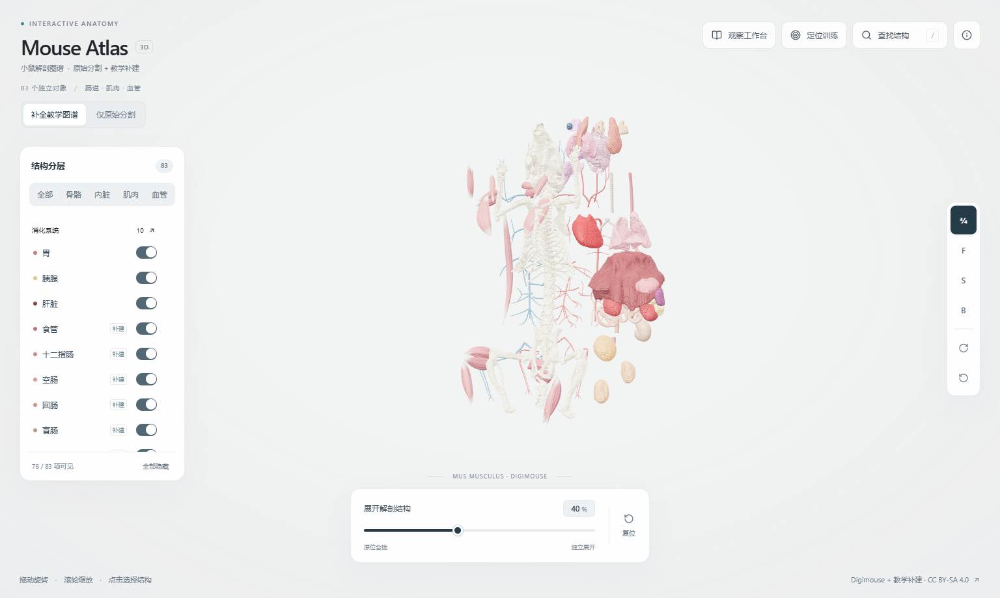

# Mouse Atlas · 小鼠三维解剖图谱

**[打开在线三维图谱](https://cream5199.github.io/mouse-anatomy-atlas/)** · [模型下载与使用说明](https://cream5199.github.io/mouse-anatomy-atlas/downloads/) · [定位训练](https://cream5199.github.io/mouse-anatomy-atlas/study/)

拖动滑杆，把合拢的小鼠展开为可单独选择的结构。点击心脏或肾脏，可以先看它在全身的位置，再单独放大、旋转或下载三维模型。这个图谱用于生物医学学习中的结构识别和空间关系预习。

图谱包含 **83 个可选对象**：27 个来自 Digimouse 原始标注，56 个是参照这些标注制作的教学模型。它们可以在界面中分开查看。



图中模型来源：Digimouse（Dogdas 等）及 Mouse Atlas 教学补建；模型署名与许可见[来源说明](THIRD_PARTY_NOTICES.md)。

## 运行

准备 Node.js 22.13 或更高版本，以及支持 WebGL 的浏览器。在终端中运行：

```sh
git clone https://github.com/Cream5199/mouse-anatomy-atlas.git
cd mouse-anatomy-atlas
npm ci
npm run dev
```

打开终端显示的本地地址。可直接使用的压缩模型已随仓库提供，运行图谱无需 Python，也无需重新生成几何。首次加载会读取数十 MB 的三维数据；体表模型在选中该图层时加载。

## 第一次观察：找到肾脏

1. 选择 **仅原始分割**，在“查找结构”中搜索“肾脏”。选中任一侧，先观察它和周围结构的相对位置。
2. 点击 **单独放大观察**，拖动旋转；点击 **恢复整体** 回到原位对照。拉动“展开解剖结构”滑杆可以分开各个对象，再将它们合拢。
3. 切换至 **补全教学图谱**，对照泌尿系统中的输尿管。详情里的“教学补建”提示表示这个结构是参照既有器官位置建模的，并非同一标本的扫描分割。

在页面顶部打开 **观察工作台**，可以保存最多 12 条本机记录，也可以复制观察链接。恢复的内容包括图层、选中结构、隔离状态、展开程度和预设视角，不包含手动拖动后的精确镜头角度。记录保存在当前浏览器；本机地址的链接不能给另一台电脑直接使用。需要跨设备分享时，接收者须能访问同一个部署地址。

## 下载模型

| 目标 | 在哪里操作 | 文件与坐标 |
| --- | --- | --- |
| 单个对象 | 在图谱里选择结构 → **下载此结构 · GLB** | 标准 GLB，可直接导入三维软件。导出使用合拢原位的坐标，单位为**米**，不受当前展开程度或选择高亮影响。来源与许可随模型写入 `extras`。 |
| 整组结构 | 运行图谱后，在“观察工作台”打开**整组模型与使用说明**（`/downloads`）；或从 [模型目录](public/models) 取文件 | 将 `.glb.gz` 解压一次得到 GLB。整组源文件保留**毫米数值**，若导入工具将 GLB 数值按米解释，需整体缩放 **0.001**。同组的 `metadata.json` 提供结构 ID 和名称。 |
| 体表 | 从 [Digimouse 模型目录](public/models/digimouse-voxel) 下载两段皮肤文件 | 先按 `part1`、`part2` 的顺序**拼接字节**，再解压一次；它们是同一个 gzip 流的两段。`/downloads` 附有拼接示例。 |

## 模型覆盖了什么？

| 来源 | 对象数 | 范围 |
| --- | ---: | --- |
| [Digimouse 原始标注重建](public/models/digimouse-voxel/ATTRIBUTION.txt) | 27 | 从 21 类原始标签提取表面，六组成对区域拆成独立对象。含体表、整体骨骼和原始标注中的器官、脑区等；每块骨头并未独立标注。 |
| [教学补建](public/models/mouse-teaching/ATTRIBUTION.txt) | 56 | 消化道、气道和泌尿管道共 12 个，区域动静脉树 18 个，躯干和四肢肌群 26 个。 |

83 指对象数，不等于 83 种器官。成对结构的 A / B 表示源坐标中的两个部分，尚未核实为解剖左 / 右。Digimouse 的 0.1 mm 是体素标注网格的间距，不是所有表面的精度保证。补建的肠道路径、血管分支和肌肉附着未经标本测量或专家验证，不能用于确定实际取材位置、手术规划或精密测量。

## 静态部署

域名根路径使用 `npm run build`；本项目的 GitHub Pages 子路径 `/mouse-anatomy-atlas/` 使用 `npm run build:pages`。将 `dist/` 的内容（包括 `.nojekyll` 和全部模型）发布到静态服务器。使用 `npm run preview:pages` 可在本机预览 Pages 路径。

## 开发与校验

- `npm run build`：校验来源文件和解压后的几何数据，再构建应用。
- `node scripts/verify-voxel-assets.mjs`：只检查随仓库提供的模型，不会重新建模。
- `node scripts/check-observation.mjs`：检查观察状态恢复、导出坐标和来源信息。
- `/study`：进入隐藏标签的内脏定位练习。

只有需要重新生成模型时才需要 Python 环境。先阅读 [原始标签表面重建](scripts/voxel/README.md)，再按需运行 [教学模型生成流程](scripts/teaching/README.md)。

## 来源与许可

本项目新增应用代码采用 [MIT](LICENSE)。交互界面及展开布局参考 [ashemag/human-atlas](https://github.com/ashemag/human-atlas)，保留[上游 MIT 声明](public/licenses/human-atlas.txt)。原始 Digimouse 来源、派生几何、教学几何和教学建模脚本适用各自声明的 **CC BY-SA 4.0**；复用模型时请保留署名、来源、许可及修改说明。

各文件的适用范围、Digimouse 论文和可随模型附带的署名示例见 [THIRD_PARTY_NOTICES.md](THIRD_PARTY_NOTICES.md)。如果结构有标注疑问，欢迎提出 Issue，附上结构名称或 ID、当前模型范围，以及可供核对的参考资料。
